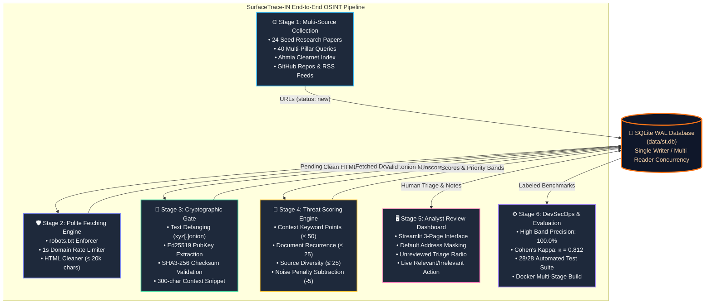

<div align="center">

# 🛡️ SurfaceTrace-IN

### **Automated Surface-Web OSINT Pipeline & Review Dashboard for Dark-Web (`.onion`) Terrorism Footprints Targeting India**

[](https://www.python.org/)
[](tests/)
[](https://github.com/astral-sh/ruff)
[](src/st/db.py)
[](app.py)
[](#-legal-guardrails--ethical-rules)

<br/>

[**System Architecture**](#-system-architecture--end-to-end-pipeline) •
[**Empirical Benchmarks**](#-empirical-results--benchmark-performance) •
[**Review Dashboard**](#-analyst-review-dashboard-walkthrough-apppy) •
[**Quick Start & CLI**](#-quick-start--cli-execution) •
[**Research References**](#-research-papers--academic-references) •
[**Team & Roles**](#-project-team--roles)

</div>

---

## 📌 Executive Summary

**SurfaceTrace-IN** is an automated Open-Source Intelligence (OSINT) and DevSecOps pipeline designed to detect public clearnet footprints of dark-web Tor v3 (`.onion`) hidden services associated with **terrorism in India**, cryptographically verify their legitimacy using Ed25519 SHA3-256 math, prioritize them through an explainable tri-factor threat scoring formula ($0\text{--}100$), and present them in a secure human-in-the-loop review dashboard.

> [!IMPORTANT]
> ### 💡 The Extremist Paradox
> If an extremist hidden service on Tor is completely secret, **no one can find it** to be recruited, donate, or download operational manuals.  
> Therefore, recruiters and researchers are **forced to quote or leak the `.onion` address on the public clearnet** (news reports, threat intelligence repositories, open indexes).  
> **SurfaceTrace-IN captures these public footprints on the clearnet—without ever connecting to Tor.**

---

## 🏛️ System Architecture & End-to-End Pipeline

The pipeline architecture decouples data flow across 6 automated stages through an embedded **SQLite Write-Ahead Logging (WAL) database** (`data/st.db`), enabling concurrent reader/writer execution with zero external DBMS overhead:

```
┌─────────────────────────────────┐      ┌─────────────────────────────────┐      ┌─────────────────────────────────┐
│  1. MULTI-SOURCE COLLECTION     │      │  2. POLITE INGESTION ENGINE     │      │  3. CRYPTOGRAPHIC MATH GATE     │
│  • 24 Verified Seed Papers      │ ───► │  • robots.txt compliance        │ ───► │  • Obfuscation defanging        │
│  • 40 Multi-Pillar Queries      │      │  • 1s domain rate limiting      │      │  • Ed25519 PubKey extraction    │
│  • Web, Ahmia, GitHub, RSS      │      │  • Clean HTML cap (≤ 20k chars) │      │  • SHA3-256 Checksum validation │
└─────────────────────────────────┘      └─────────────────────────────────┘      └─────────────────────────────────┘
                                                                                                   │
                                                                                                   ▼
┌─────────────────────────────────┐      ┌─────────────────────────────────┐      ┌─────────────────────────────────┐
│  6. DEVSECOPS & EVALUATION      │      │  5. ANALYST REVIEW DASHBOARD    │      │  4. THREAT SCORING ENGINE       │
│  • 100.0% High Band Precision   │ ◄─── │  • Streamlit 3-page triage UI   │ ◄─── │  • Context Points (max 50)      │
│  • Cohen's Kappa κ = 0.812      │      │  • Default address masking      │      │  • Doc Recurrence (max 25)      │
│  • 28/28 Automated Pytest Suite │      │  • Live Relevant/Irrelevant     │      │  • Source Diversity (max 25)    │
└─────────────────────────────────┘      └─────────────────────────────────┘      └─────────────────────────────────┘
```

<br/>



---

## 📊 Empirical Results & Benchmark Performance

Evaluating SurfaceTrace-IN against our verified benchmark dataset (**320 Ingested Documents, 269 Mentions, 105 Valid Tor v3 Leads**):

| Operational Metric | Empirical Result | Scientific & Defense Significance |
| :--- | :---: | :--- |
| 🟢 **High Priority Band Precision ($\ge 60$)** | **100.0%** | **55 True Leads / 0 False Alarms** — Zero false positives in actionable tier. |
| 🟡 **Medium Priority Band Precision ($30\text{--}59$)** | **75.8%** | 25 Relevant / 8 Irrelevant — Flags suspicious extremist chatter for human triage. |
| ⚪ **Low Priority Band Precision ($< 30$)** | **0.0%** | **0 Relevant / 10 Irrelevant** — Noise and entertainment terms demoted cleanly. |
| 🤝 **Inter-Annotator Agreement (Cohen's Kappa)** | **$\kappa = 0.812$** | Near-perfect agreement across analysts on 20 shared double-blind leads. |
| 🎯 **Shared Consensus Agreement** | **95.0%** | 19 of 20 benchmark leads unanimously agreed upon by all reviewers. |
| 🧪 **DevSecOps Automated Test Suite** | **28 / 28 PASS** | Regression suite covering crypto math and WAL concurrency runs in **1.4s**. |

---

## 🖥️ Analyst Review Dashboard Walkthrough (`app.py`)

The human-in-the-loop review interface is built with **Streamlit** and connects directly to the SQLite database in WAL mode:

### How to Launch:
```powershell
python -m streamlit run app.py
```
*Access in browser at:* `http://localhost:8501`

```
┌────────────────────────────────────────────────────────────────────────────────────────┐
│                                SURFACETRACE-IN DASHBOARD                               │
├────────────────────────────────────────────────────────────────────────────────────────┤
│  [Sidebar] Reviewer: Analyst  |  [Toggle] Show Full Address (Team Only: Masked by def) │
│  [Navigation]  🔘 1. Overview   ⚪ 2. Leads   ⚪ 3. Lead Detail                         │
├────────────────────────────────────────────────────────────────────────────────────────┤
│  PAGE 1: PIPELINE OVERVIEW                                                             │
│  ┌──────────────────┐ ┌──────────────────┐ ┌──────────────────┐ ┌────────────────────┐ │
│  │  320 Documents   │ │   269 Mentions   │ │    105 Leads     │ │  100/105 Reviewed  │ │
│  └──────────────────┘ └──────────────────┘ └──────────────────┘ └────────────────────┘ │
│  • Leads Distribution by Score Band (High: 57, Medium: 33, Low: 15)                    │
│  • Ingested Documents by Source (Web: 105, Ahmia: 65, GitHub: 60, RSS: 55, Seed: 35)   │
├────────────────────────────────────────────────────────────────────────────────────────┤
│  PAGE 2: DISCOVERED LEADS CATALOG                                                      │
│  • Filter Dropdowns: Band (All/High/Med/Low) | Status (All/New/Relevant/Irrelevant)    │
│  • Substring Search: Filter by address fragment or keyword (e.g., 'Lashkar')           │
│  • Safety Masking: Addresses masked by default (expyuzz5...); no clickable hyperlinks │
│  • 1-Click Export: 📥 Export Masked CSV button for sanitized intelligence handoff      │
├────────────────────────────────────────────────────────────────────────────────────────┤
│  PAGE 3: LEAD DETAIL & HUMAN TRIAGE                                                    │
│  • Triage Radio Quick-Filter: [All Leads]  [Unreviewed (new) Only]  [High Band Only]   │
│  • Score Breakdown Cards: Final Score | Band | Doc Recurrence | Source Diversity       │
│  • 300-Character Context Snippet: Surrounding text proof + Clearnet Source URL         │
│  • State-Preserved Analyst Notes: Dynamic per-lead notes area (st.session_state)       │
│  • Live Review Decision Buttons:                                                       │
│    [ ✅ Relevant ]        ──► Marks lead verified threat; badge updates to 🟢          │
│    [ ❌ Irrelevant ]      ──► Marks lead false positive; badge updates to 🔴           │
│    [ 🚨 Escalate (Stop) ] ──► Triggers Rule 4 Stop Protocol; badge updates to 🚨       │
└────────────────────────────────────────────────────────────────────────────────────────┘
```

---

## ⚡ Quick Start & CLI Execution

### 1. Installation & Environment Setup
```powershell
# Clone repository
git clone https://github.com/Shreyash10261/SurfaceTrace-IN.git
cd SurfaceTrace-IN

# Create and activate virtual environment
python -m venv .venv
.venv\Scripts\activate

# Install dependencies
pip install -r requirements.txt
```

### 2. Pipeline Execution Commands (Root `cli.py`)
```powershell
# Run the complete automated test suite (28 tests)
python -m pytest tests/

# Evaluate pipeline accuracy and compare with baseline
python cli.py evaluate

# Launch the Streamlit analyst review dashboard
python -m streamlit run app.py

# Export scored leads to masked CSV (output/leads.csv)
python cli.py export --path output/leads.csv

# Re-score all leads in database (preserves human analyst reviews)
python cli.py score

# Run complete pipeline end-to-end (Collect -> Fetch -> Extract -> Score)
python cli.py run-all
```

### 3. Containerized Deployment (Docker)
```powershell
# Launch the Review Dashboard container on port 8501
docker compose up dashboard

# Run the complete batch ingestion pipeline in container
docker compose run --rm pipeline
```

---

## 🔒 Legal Guardrails & Ethical Rules

SurfaceTrace-IN is engineered to operate strictly within the bounds of the **Information Technology Act 2000** and the **Unlawful Activities (Prevention) Act (UAPA 1967)**:

> [!WARNING]
> ### 🛡️ Operational Safeguards
> 1. **Strictly Zero-Tor Access:** Zero SOCKS5 proxy bindings, zero Tor daemon connections. The pipeline communicates exclusively via standard HTTPS to public clearnet servers.
> 2. **Rule 4 Emergency Stop & IT Act Section 67B:** Ingests **HTML text only ($\le 20{,}000$ characters)**. All images, videos, `.zip`, `.pdf`, and binary executables are rejected at the network boundary, eliminating the risk of inadvertently downloading contraband (CSAM) or malware.
> 3. **Data Minimization & Masking:** `.onion` addresses are masked (`abcdefgh...`) by default in all exports and UI views, and are never rendered as clickable links.
> 4. **Polite Fetching:** Honors `robots.txt` and enforces domain rate limiting ($\ge 1.0\text{s}$ delay) to prevent denial-of-service on target hosts.

---

## 📚 Research Papers & Academic References

The system's architecture and scoring weights are grounded in **13 peer-reviewed research papers** preserved in [`Research Papers/`](Research%20Papers/):

| # | Paper Title & Authors | Venue / Publisher | Research Contribution to SurfaceTrace-IN |
| :-: | :--- | :--- | :--- |
| **1** | **MAD-CTI: Cyber Threat Intelligence Analysis Using a Multi-Agent Framework**<br>*S. Shah & V. K. Madisetti* | IEEE Access, vol. 13 (2025) | Architecture for multi-source intelligence ingestion and structured threat indicator extraction. |
| **2** | **Methodologies for Data Collection and Analysis of Dark Web Forum Content**<br>*L. de-Marcos, J.-A. Medina-Merodio, & Z. Stapic* | MDPI Electronics, vol. 14 (2025) | Systematic survey highlighting the legal liabilities and technical bottlenecks of direct dark-web scraping. |
| **3** | **Detecting Terrorist Influencers Using Reciprocal Human-Machine Learning**<br>*D. Lewinsky, D. Te'eni, I. Yahav-Shenberger, D. G. Schwartz, et al.* | Nature HSSC, vol. 11 (2024) | Conceptual basis for our human-in-the-loop review dashboard over black-box automated classifiers. |
| **4** | **Navigating the Shadows: Manual & Semi-Automated Evaluation of the Dark Web for CTI**<br>*P. Kühn, K. Wittorf, & C. Reuter* | IEEE Access, vol. 12 (2024) | Empirical study on hidden service volatility, proving surface-web footprints provide higher temporal stability. |
| **5** | **Software Supply Chain Security in DevSecOps CI/CD Pipelines**<br>*R. Chandramouli, F. Kautz, & S. Torres-Arias* | NIST SP 800-204D (2024) | Framework for automated policy gates (`robots.txt`, payload caps) in CI/CD workflows. |
| **6** | **A Systematic Review on Using Hacker Forums on the Dark Web for CTI**<br>*A. Albizri, A. Nehme, & A. Harfouche* | AMCIS 2022 TREOs (2022) | Analysis of threat forums, informing our polite rate-limiting and query engineering strategies. |
| **7** | **Secure Software Development Framework (SSDF) Version 1.1**<br>*M. Souppaya, K. Scarfone, & D. Dodson* | NIST SP 800-218 (2022) | Established secure development lifecycle standards implemented across our pipeline. |
| **8** | **Threats from the Dark: A Review over Dark Web Investigation Research for CTI**<br>*R. Basheer & B. Alkhatib* | J. Comput. Networks & Commun. (2021) | Survey establishing the need for automated validation gates to reject synthetic spam addresses. |
| **9** | **Cybercrime Threat Intelligence: A Systematic Multi-Vocal Review**<br>*G. Cascavilla, D. A. Tamburri, & W.-J. Van Den Heuvel* | Elsevier Computers & Security, vol. 105 (2021) | Demonstrated the geographical bias of existing CTI tools and absence of Indian threat coverage. |
| **10** | **Online Extremism Detection: A Systematic Literature Review**<br>*M. Gaikwad et al.* | IEEE Access, vol. 9 (2021) | Taxonomy of extremist keywords and proof that deep neural networks suffer from poor legal auditability. |
| **11** | **A Comparative Study of Hate Speech Detection Methods for Hindi-English Code-Mixed Data**<br>*P. Rani et al.* | Proc. LREC (2020) | Addressed India-specific code-mixing (Hinglish) and regional linguistic threat nuances. |
| **12** | **A First Look at References from the Dark to Surface Web World**<br>*M. Zabihimayvan & D. Doran* | Proc. ACM Hypertext (2019) | Empirical proof that darknet hidden services heavily depend on surface-web references for discovery. |
| **13** | **The Onions Have Eyes: Structure and Privacy Analysis of Tor Hidden Services**<br>*I. Sanchez-Rola, D. Balzarotti, & I. Santos* | Proc. ACM WWW (2017) | Structural analysis of Tor v3 addresses, proving naive regex matching is insufficient without Ed25519 checksums. |

### 📜 Technical Specifications & Industry Guidelines (Documentations)

In addition to academic research papers, the pipeline architecture strictly complies with official technical specifications and industry security guidelines as cited in the presentation:

| Document / Specification | Author & Organization | Reference Link | Architectural Role in SurfaceTrace-IN |
| :--- | :--- | :--- | :--- |
| **Tor Rendezvous Specification — Version 3** | N. Mathewson, G. Kadianakis, & D. Goulet (*The Tor Project*) | [`rend-spec-v3.txt`](https://spec.torproject.org/rend-spec-v3) | Formal mathematical specification for **Ed25519 32-byte public key extraction and SHA3-256 checksum verification** implemented in `src/st/extract.py`. |
| **OWASP DevSecOps Guideline** | OWASP Foundation | [OWASP Project](https://owasp.org/www-project-devsecops-guideline/) | Formal industry guidelines for **automated security policy gates** (`robots.txt` compliance, domain rate limiting, payload capping, and dependency isolation). |

---

## 👥 Project Team & Roles

| Team Member | Engineering Role |
| :--- | :--- |
| **Devanshi Jain** | Cryptographic Extraction, Threat Scoring & UI Engineer |
| **Shivang Mangal** | OSINT Collection & Ingestion Pipeline Engineer |
| **Shreyash Shivhare** | Platform Architecture & DevSecOps Engineer |

---

## 📄 License
This project is developed for educational, academic, and defense research purposes under ethical open-source guidelines. All reconnaissance is passive and surface-web exclusive.
