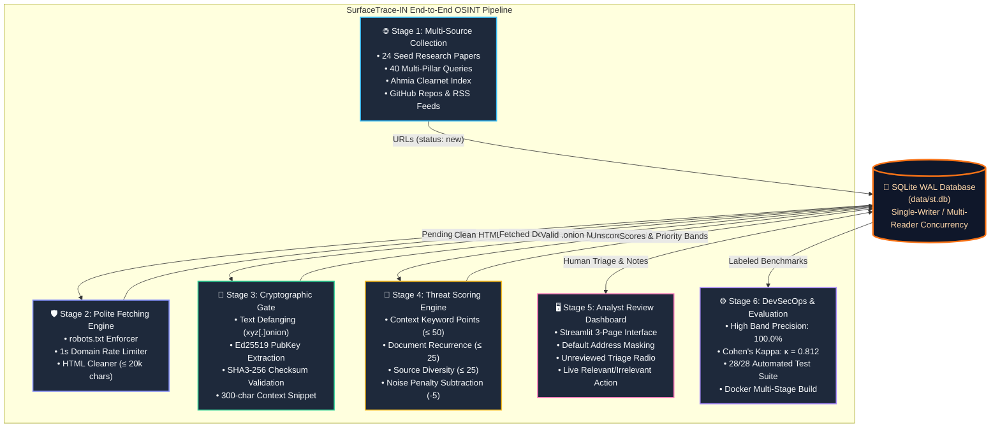

# SurfaceTrace-IN 🛡️
> **Automated Surface-Web OSINT Pipeline & Review Dashboard for Dark-Web (`.onion`) Terrorism Footprints Targeting India**

[](https://www.python.org/)
[](tests/)
[](https://github.com/astral-sh/ruff)
[](src/st/db.py)
[](app.py)
[](#-legal-guardrails--ethical-rules)

---

## 📌 Executive Summary

**SurfaceTrace-IN** is an automated Open-Source Intelligence (OSINT) and DevSecOps pipeline designed to detect public clearnet footprints of dark-web Tor v3 (`.onion`) hidden services associated with **terrorism in India**, cryptographically verify their legitimacy using Ed25519 SHA3-256 math, prioritize them through an explainable tri-factor threat scoring formula ($0\text{--}100$), and present them in a secure human-in-the-loop review dashboard.

```
                         THE EXTREMIST PARADOX
┌────────────────────────────────────────────────────────────────────────┐
│  If an extremist hidden service on Tor is completely secret, NO ONE    │
│  can find it to be recruited, donate, or download manuals.             │
│                                                                        │
│  Therefore, recruiters & researchers are FORCED to leak or quote the   │
│  .onion address on the public clearnet (news, pastebins, open indexes). │
│                                                                        │
│  ───► That public footprint is where SurfaceTrace-IN captures them! ◄── │
└────────────────────────────────────────────────────────────────────────┘
```

---

## 🏛️ System Architecture & End-to-End Pipeline

The pipeline architecture decouples data flow across 6 automated stages through an embedded **SQLite Write-Ahead Logging (WAL) database**:

```
┌─────────────────────────┐     ┌─────────────────────────┐     ┌─────────────────────────┐
│ 1. MULTI-SOURCE         │     │ 2. POLITE INGESTION     │     │ 3. CRYPTOGRAPHIC        │
│    COLLECTION           │ ──► │    ENGINE               │ ──► │    MATH GATE            │
│ • 24 Curated Seed URLs  │     │ • robots.txt compliance │     │ • Defanging ([.]onion)  │
│ • 40 Search Queries     │     │ • 1s/domain rate limit  │     │ • Ed25519 SHA3-256 Math │
│ • Ahmia, GitHub, RSS    │     │ • Cap text ≤ 20k chars  │     │ • 300-char context cut  │
└─────────────────────────┘     └─────────────────────────┘     └─────────────────────────┘
                                                                             │
                                                                             ▼
┌─────────────────────────┐     ┌─────────────────────────┐     ┌─────────────────────────┐
│ 6. DEVSECOPS &          │     │ 5. ANALYST REVIEW       │     │ 4. THREAT SCORING       │
│    BENCHMARK EVALUATION │ ◄── │    DASHBOARD            │ ◄── │    MODEL (0 - 100)      │
│ • 100% High Band Prec.  │     │ • Streamlit 3-Page UI   │     │ • Context (max 50)      │
│ • Cohen's Kappa = 0.812 │     │ • Masked Addresses      │     │ • Recurrence (max 25)   │
│ • 28/28 Automated Tests │     │ • Live Triage & Notes   │     │ • Diversity (max 25)    │
└─────────────────────────┘     └─────────────────────────┘     └─────────────────────────┘
```



---

## 📚 Research Papers & Academic References

The system's architecture and scoring weights are grounded in **13 peer-reviewed research papers** preserved in [`Research Papers/`](Research%20Papers/):

| # | Paper Title & Authors | Venue / Publisher | Research Contribution to SurfaceTrace-IN |
| :-: | :--- | :--- | :--- |
| **1** | **MAD-CTI: Cyber Threat Intelligence Analysis Using a Multi-Agent Framework**<br>*S. Shah & V. K. Madisetti* | IEEE Access, vol. 13 (2025) | Architecture for multi-source intelligence ingestion and structured threat indicator extraction. |
| **2** | **Methodologies for Data Collection and Analysis of Dark Web Forum Content**<br>*L. de-Marcos, J.-A. Medina-Merodio, & Z. Stapic* | MDPI Electronics, vol. 14 (2025) | Systematic survey highlighting the legal liabilities and technical bottlenecks of direct dark-web scraping. |
| **3** | **Detecting Terrorist Influencers Using Reciprocal Human-Machine Learning**<br>*D. Lewinsky, D. Te'eni, I. Yahav-Shenberger, D. G. Schwartz, et al.* | Nature HSSC, vol. 11 (2024) | Conceptual basis for our human-in-the-loop review dashboard over black-box automated classifiers. |
| **4** | **Navigating the Shadows: Manual & Semi-Automated Evaluation of the Dark Web for CTI**<br>*P. Kühn, K. Wittorf, & C. Reuter* | IEEE Access, vol. 12 (2024) | Empirical study on hidden service volatility, proving surface-web footprints provide higher temporal stability. |
| **5** | **Software Supply Chain Security in DevSecOps CI/CD Pipelines**<br>*R. Chandramouli, F. Kautz, & S. Torres-Arias* | NIST SP 800-204D (2024) | Framework for automated policy gates (`robots.txt`, payload caps) in CI/CD workflows. |
| **6** | **A Systematic Review on Using Hacker Forums on the Dark Web for CTI**<br>*A. Albizri, A. Nehme, & A. Harfouche* | AMCIS 2022 TREOs (2022) | Analysis of threat forums, informing our polite rate-limiting and query engineering strategies. |
| **7** | **Secure Software Development Framework (SSDF) Version 1.1**<br>*M. Souppaya, K. Scarfone, & D. Dodson* | NIST SP 800-218 (2022) | Established secure development lifecycle standards implemented across our pipeline. |
| **8** | **Threats from the Dark: A Review over Dark Web Investigation Research for CTI**<br>*R. Basheer & B. Alkhatib* | J. Comput. Networks & Commun. (2021) | Survey establishing the need for automated validation gates to reject synthetic spam addresses. |
| **9** | **Cybercrime Threat Intelligence: A Systematic Multi-Vocal Review**<br>*G. Cascavilla, D. A. Tamburri, & W.-J. Van Den Heuvel* | Elsevier Computers & Security, vol. 105 (2021) | Demonstrated the geographical bias of existing CTI tools and absence of Indian threat coverage. |
| **10** | **Online Extremism Detection: A Systematic Literature Review**<br>*M. Gaikwad et al.* | IEEE Access, vol. 9 (2021) | Taxonomy of extremist keywords and proof that deep neural networks suffer from poor legal auditability. |
| **11** | **A Comparative Study of Hate Speech Detection Methods for Hindi-English Code-Mixed Data**<br>*P. Rani et al.* | Proc. LREC (2020) | Addressed India-specific code-mixing (Hinglish) and regional linguistic threat nuances. |
| **12** | **A First Look at References from the Dark to Surface Web World**<br>*M. Zabihimayvan & D. Doran* | Proc. ACM Hypertext (2019) | Empirical proof that darknet hidden services heavily depend on surface-web references for discovery. |
| **13** | **The Onions Have Eyes: Structure and Privacy Analysis of Tor Hidden Services**<br>*I. Sanchez-Rola, D. Balzarotti, & I. Santos* | Proc. ACM WWW (2017) | Structural analysis of Tor v3 addresses, proving naive regex matching is insufficient without Ed25519 checksums. |

### 📜 Technical Specifications & Industry Guidelines (Documentations)

In addition to academic research papers, the pipeline architecture strictly complies with official technical specifications and industry security guidelines as cited in the presentation:

| Document / Specification | Author & Organization | Link / Reference | Architectural Role in SurfaceTrace-IN |
| :--- | :--- | :--- | :--- |
| **Tor Rendezvous Specification — Version 3** | N. Mathewson, G. Kadianakis, & D. Goulet (*The Tor Project*) | [`rend-spec-v3.txt`](https://spec.torproject.org/rend-spec-v3) | Formal mathematical specification for **Ed25519 32-byte public key extraction and SHA3-256 checksum verification** implemented in `src/st/extract.py`. |
| **OWASP DevSecOps Guideline** | OWASP Foundation | [OWASP Project](https://owasp.org/www-project-devsecops-guideline/) | Formal industry guidelines for **automated security policy gates** (`robots.txt` compliance, domain rate limiting, payload capping, and dependency isolation). |

---

## 📊 Empirical Results & Benchmark Performance

Evaluating SurfaceTrace-IN against our verified benchmark dataset (**320 Documents, 269 Mentions, 105 Valid Leads**):

| Metric | Measured Result | Operational Significance |
| :--- | :---: | :--- |
| **High Priority Band Precision ($\ge 60$)** | **100.0%** | **55 True Leads / 0 False Alarms** in top tier. |
| **Medium Priority Band Precision ($30\text{--}59$)** | **75.8%** | 25 Relevant / 8 Irrelevant (suspicious chatter). |
| **Low Priority Band Precision ($< 30$)** | **0.0%** | Noise and movies successfully demoted to bottom. |
| **Inter-Annotator Agreement (Cohen's Kappa)** | **$\kappa = 0.812$** | Near-perfect consensus across analysts on shared 20 leads. |
| **Shared Consensus Agreement** | **95.0%** | 19 of 20 leads unanimously agreed upon. |
| **Automated Test Coverage** | **28 / 28 Pass** | Complete regression suite executes in **1.4 seconds**. |

---

## 🖥️ Analyst Review Dashboard Walkthrough (`app.py`)

The human-in-the-loop triage interface runs on Streamlit and connects directly to the SQLite WAL database:

### How to Launch:
```powershell
python -m streamlit run app.py
```
*Access in browser at:* `http://localhost:8501`

```
┌─────────────────────────────────────────────────────────────────────────────┐
│                          SURFACETRACE-IN DASHBOARD                          │
├─────────────────────────────────────────────────────────────────────────────┤
│  [Sidebar] Reviewer: Analyst  |  [Toggle] Mask Onion (expyuzz5...)          │
│  [Navigation]  1. Overview  |  2. Leads  |  3. Lead Detail                  │
├─────────────────────────────────────────────────────────────────────────────┤
│  PAGE 1: PIPELINE OVERVIEW                                                  │
│  ┌───────────────┐ ┌───────────────┐ ┌───────────────┐ ┌──────────────────┐ │
│  │ 320 Documents │ │  269 Mentions │ │   105 Leads   │ │ 100/105 Reviewed │ │
│  └───────────────┘ └───────────────┘ └───────────────┘ └──────────────────┘ │
│  • Leads Distribution by Score Band (High: 57, Medium: 33, Low: 15)         │
│  • Ingested Documents by Source (Web: 105, Ahmia: 65, GitHub: 60, RSS: 55) │
├─────────────────────────────────────────────────────────────────────────────┤
│  PAGE 2: DISCOVERED LEADS CATALOG                                           │
│  • Filters: Band (High/Med/Low) | Status (New/Relevant/Irrelevant/Escalate) │
│  • Real-Time Search: Address substring or threat keyword (e.g., 'Lashkar')  │
│  • Safety: Addresses masked by default (expyuzz5...); no clickable links   │
│  • 1-Click Export: 📥 Export Masked CSV button for field dissemination       │
├─────────────────────────────────────────────────────────────────────────────┤
│  PAGE 3: LEAD DETAIL & TRIAGE                                               │
│  • Quick Triage Radio: [All Leads] [Unreviewed (new) Only] [High Band Only] │
│  • Score Breakdown Metric Cards (Score, Band, Doc Count, Source Count)      │
│  • 300-Character Context Snippet: Surrounding text proof + Clearnet URL    │
│  • State-Preserved Analyst Notes: Independent textarea per lead             │
│  • Live Review Action Buttons:                                              │
│    [✅ Relevant]        ──► Marks lead verified, updates badge to 🟢        │
│    [❌ Irrelevant]      ──► Marks false positive, updates badge to 🔴       │
│    [🚨 Escalate (Stop)] ──► Triggers Rule 4 Stop, updates badge to 🚨       │
└─────────────────────────────────────────────────────────────────────────────┘
```

---

## ⚡ Quick Start & CLI Execution

### 1. Prerequisites & Installation
```powershell
# Clone repository
git clone https://github.com/Shreyash10261/SurfaceTrace-IN.git
cd SurfaceTrace-IN

# Create virtual environment
python -m venv .venv
.venv\Scripts\activate

# Install dependencies
pip install -r requirements.txt
```

### 2. Run Commands (Using Root `cli.py`)
```powershell
# 1. Run automated test suite (28 tests)
python -m pytest tests/

# 2. View evaluation metrics and baseline comparison
python cli.py evaluate

# 3. Launch human review dashboard
python -m streamlit run app.py

# 4. Export leads to masked CSV
python cli.py export --path output/leads.csv

# 5. Re-score all leads in database (preserves analyst notes)
python cli.py score

# 6. Execute entire pipeline end-to-end
python cli.py run-all
```

### 3. Docker Deployment
```powershell
# Launch the Review Dashboard in container on port 8501
docker compose up dashboard

# Run the end-to-end collection & scoring pipeline
docker compose run --rm pipeline
```

---

## 🔒 Legal Guardrails & Ethical Rules

SurfaceTrace-IN is engineered to operate strictly within the legal bounds of the **Information Technology Act 2000** and the **Unlawful Activities (Prevention) Act (UAPA)**:

1. **Strictly Zero-Tor Access:** Zero SOCKS5 proxy bindings, zero Tor daemon connections. Operates 100% on public clearnet web text.
2. **Rule 4 Emergency Stop & IT Act Section 67B:** Ingests **HTML text only ($\le 20{,}000$ chars)**. Images, videos, `.zip`, `.pdf`, and binary executables are rejected to prevent downloading malware or illicit contraband (CSAM).
3. **Data Minimization:** `.onion` addresses are masked (`abcdefgh...`) by default in all exports and UI views, and are never rendered as clickable links.
4. **Polite Ingestion:** Honors `robots.txt` and enforces domain rate limiting ($\ge 1.0\text{s}$ delay) to avoid server load.

---

## 👥 Project Team & Roles

| Team Member | Engineering Role |
| :--- | :--- |
| **Devanshi Jain** | Lead — Extraction, Threat Scoring & Review Dashboard |
| **Shivang Mangal** | Lead — Collection, Seed Curation & Ingestion Layer |
| **Shreyash Shivhare** | Lead — Platform Architecture, DevSecOps CI/CD & Evaluation |

---

## 📄 License
This project is developed for educational, academic, and defense research purposes under ethical open-source guidelines. All reconnaissance is passive and surface-web exclusive.
