# SurfaceTrace-IN 🛡️
> **Automated Surface-Web OSINT Pipeline & Review Dashboard for Dark-Web (`.onion`) Terrorism Footprints Targeting India**

[](https://www.python.org/)
[](tests/)
[](https://github.com/astral-sh/ruff)
[](src/st/db.py)
[](app.py)
[](#-legal-guardrails--ethical-rules)

---

## 📌 Executive Summary

**SurfaceTrace-IN** is an automated Open-Source Intelligence (OSINT) and DevSecOps pipeline designed to detect public clearnet footprints of dark-web Tor v3 (`.onion`) hidden services associated with **terrorism in India**, cryptographically verify their legitimacy using Ed25519 SHA3-256 math, prioritize them through an explainable tri-factor threat scoring formula ($0\text{--}100$), and present them in a secure human-in-the-loop review dashboard.

```
                         THE EXTREMIST PARADOX
┌────────────────────────────────────────────────────────────────────────┐
│  If an extremist hidden service on Tor is completely secret, NO ONE    │
│  can find it to be recruited, donate, or download manuals.             │
│                                                                        │
│  Therefore, recruiters & researchers are FORCED to leak or quote the   │
│  .onion address on the public clearnet (news, pastebins, open indexes). │
│                                                                        │
│  ───► That public footprint is where SurfaceTrace-IN captures them! ◄── │
└────────────────────────────────────────────────────────────────────────┘
```

---

## 🏛️ System Architecture

```mermaid
flowchart LR
    subgraph S1["1. Collection Layer"]
        A1["Seed Research Papers"]
        A2["Web Search (40 Queries)"]
        A3["Ahmia Clearnet Index"]
        A4["GitHub Threat Repos"]
        A5["Cybersecurity RSS Feeds"]
    end

    subgraph S2["2. Polite Fetching"]
        B1["robots.txt Enforcer"]
        B2["Rate Limiter (1s delay)"]
        B3["Text Extractor (max 20k chars)"]
    end

    subgraph S3["3. Cryptographic Extraction"]
        C1["Defanging ([.]onion)"]
        C2["Tor v3 Checksum Gate (SHA3-256)"]
        C3["300-char Context Snippet"]
    end

    subgraph S4["4. Threat Scoring"]
        D1["Context Score (max 50)"]
        D2["Recurrence (max 25)"]
        D3["Source Diversity (max 25)"]
        D4["Banding: High / Med / Low"]
    end

    subgraph S5["5. Analyst Review"]
        E1["Streamlit Dashboard"]
        E2["Masked Addresses"]
        E3["Relevant / Irrelevant / Escalate"]
    end

    subgraph S6["6. DevSecOps & Eval"]
        F1["Precision per Band"]
        F2["Baseline Comparison"]
        F3["28/28 Automated Pytest Suite"]
    end

    S1 --> S2 --> S3 --> S4 --> S5 --> S6
```



All pipeline stages decouple data flow through an embedded **SQLite database in Write-Ahead Logging (WAL) mode** (`data/st.db`), enabling concurrent reader/writer execution with zero external database server overhead.

---

## 📚 Literature Review & Theoretical Foundation

The project's architectural decisions synthesize findings from **13 peer-reviewed research papers** across four critical domains:

```
                               LITERATURE REVIEW MATRIX
┌───────────────────────────────────────────────┬───────────────────────────────────────────────┐
│ 1. Surface-to-Darknet References & Forensics  │ 2. Extremism Detection & CTI Frameworks       │
│ • Faizan & Schwittmann (2020): Proved that    │ • Sarker et al. (2023): Validated human-in-   │
│   dark-web sites heavily rely on clearnet     │   the-loop ML for Jihadist Da'wa analysis.    │
│   mentions for initial audience discovery.    │ • MAD-CTI (2024): Demonstrated multi-agent    │
│ • "The Onions Have Eyes" (2018): Tor v3       │   threat ingestion for dark-web surveillance. │
│   structure & Ed25519 checksum mechanics.     │ • Systematic reviews on hacker forums & CTI.  │
├───────────────────────────────────────────────┼───────────────────────────────────────────────┤
│ 3. Extremist Text & Multilingual NLP          │ 4. DevSecOps & Secure Software Supply Chain   │
│ • Hindi-English Code-Mixed Hate Speech (2022):│ • NIST SSDF SP 800-218: Secure development    │
│   Addressed India-specific dialect challenges.│   framework practices embedded into CI/CD.    │
│ • Extremism Detection Datasets & Taxonomy     │ • DevSecOps CI/CD Integration (2023): Policy  │
│   (2023): Context keyword weights formulation.│   gates for automated regression testing.     │
└───────────────────────────────────────────────┴───────────────────────────────────────────────┘
```

---

## 📊 Empirical Results & Benchmark Performance

Evaluating SurfaceTrace-IN against our verified benchmark dataset (**320 Documents, 269 Mentions, 105 Valid Leads**):

| Metric | Measured Result | Significance |
| :--- | :---: | :--- |
| **High Priority Band Precision ($\ge 60$)** | **100.0%** | **55 True Leads / 0 False Alarms** in top tier. |
| **Medium Priority Band Precision ($30\text{--}59$)** | **75.8%** | 25 Relevant / 8 Irrelevant (suspicious chatter). |
| **Low Priority Band Precision ($< 30$)** | **0.0%** | Noise and movies successfully demoted to bottom. |
| **Inter-Annotator Agreement (Cohen's Kappa)** | **$\kappa = 0.812$** | Near-perfect consensus across analysts on shared 20 leads. |
| **Shared Consensus Agreement** | **95.0%** | 19 of 20 leads unanimously agreed upon. |
| **Automated Test Coverage** | **28 / 28 Pass** | Complete regression suite executes in **1.4 seconds**. |

---

## 🖥️ Analyst Review Dashboard Walkthrough (`app.py`)

The human-in-the-loop triage interface runs on Streamlit and connects to the SQLite WAL database:

### How to Launch:
```powershell
python -m streamlit run app.py
```
*Access in browser at:* `http://localhost:8501`

```
┌─────────────────────────────────────────────────────────────────────────────┐
│                          SURFACETRACE-IN DASHBOARD                          │
├─────────────────────────────────────────────────────────────────────────────┤
│  [Sidebar] Reviewer: Analyst  |  [Toggle] Mask Onion (expyuzz5...)          │
│  [Navigation]  1. Overview  |  2. Leads  |  3. Lead Detail                  │
├─────────────────────────────────────────────────────────────────────────────┤
│  PAGE 1: OVERVIEW                                                           │
│  ┌───────────────┐ ┌───────────────┐ ┌───────────────┐ ┌──────────────────┐ │
│  │ 320 Documents │ │  269 Mentions │ │   105 Leads   │ │ 100/105 Reviewed │ │
│  └───────────────┘ └───────────────┘ └───────────────┘ └──────────────────┘ │
│  • Leads Distribution by Score Band (High: 57, Medium: 33, Low: 15)         │
│  • Ingested Documents by Source (Web: 105, Ahmia: 65, GitHub: 60, RSS: 55) │
├─────────────────────────────────────────────────────────────────────────────┤
│  PAGE 2: LEADS CATALOG                                                      │
│  • Filters: Band (High/Med/Low) | Status (New/Relevant/Irrelevant/Escalate) │
│  • Real-Time Search: Address substring or threat keyword (e.g., 'Lashkar')  │
│  • Safety: Addresses masked by default (expyuzz5...); no clickable links   │
│  • 1-Click Export: 📥 Export Masked CSV button for field dissemination       │
├─────────────────────────────────────────────────────────────────────────────┤
│  PAGE 3: LEAD DETAIL & TRIAGE                                               │
│  • Quick Triage Radio: [All Leads] [Unreviewed (new) Only] [High Band Only] │
│  • Score Breakdown Metric Cards (Score, Band, Doc Count, Source Count)      │
│  • 300-Character Context Snippet: Surrounding text proof + Clearnet URL    │
│  • State-Preserved Analyst Notes: Independent textarea per lead             │
│  • Live Review Action Buttons:                                              │
│    [✅ Relevant]        ──► Marks lead verified, updates badge to 🟢        │
│    [❌ Irrelevant]      ──► Marks false positive, updates badge to 🔴       │
│    [🚨 Escalate (Stop)] ──► Triggers Rule 4 Stop, updates badge to 🚨       │
└─────────────────────────────────────────────────────────────────────────────┘
```

---

## ⚡ Quick Start & CLI Execution

### 1. Prerequisites & Installation
```powershell
# Clone repository
git clone https://github.com/Shreyash10261/SurfaceTrace-IN.git
cd SurfaceTrace-IN

# Create virtual environment
python -m venv .venv
.venv\Scripts\activate

# Install dependencies
pip install -r requirements.txt
```

### 2. Run Commands (Using Root `cli.py`)
```powershell
# 1. Run automated test suite (28 tests)
python -m pytest tests/

# 2. View evaluation metrics and baseline comparison
python cli.py evaluate

# 3. Launch human review dashboard
python -m streamlit run app.py

# 4. Export leads to masked CSV
python cli.py export --path output/leads.csv

# 5. Re-score all leads in database (preserves analyst notes)
python cli.py score

# 6. Execute entire pipeline end-to-end
python cli.py run-all
```

### 3. Docker Deployment
```powershell
# Launch the Review Dashboard in container on port 8501
docker compose up dashboard

# Run the end-to-end collection & scoring pipeline
docker compose run --rm pipeline
```

---

## 🔒 Legal Guardrails & Ethical Rules

SurfaceTrace-IN is engineered to operate strictly within the legal bounds of the **Information Technology Act 2000** and the **Unlawful Activities (Prevention) Act (UAPA)**:

1. **Strictly Zero-Tor Access:** Zero SOCKS5 proxy bindings, zero Tor daemon connections. Operates 100% on public clearnet web text.
2. **Rule 4 Emergency Stop & IT Act Section 67B:** Ingests **HTML text only ($\le 20{,}000$ chars)**. Images, videos, `.zip`, `.pdf`, and binary executables are rejected to prevent downloading malware or illicit contraband (CSAM).
3. **Data Minimization:** `.onion` addresses are masked (`abcdefgh...`) by default in all exports and UI views, and are never rendered as clickable links.
4. **Polite Ingestion:** Honors `robots.txt` and enforces domain rate limiting ($\ge 1.0\text{s}$ delay) to avoid server load.

---

## 👥 Team & Architectural Roles

| Team Member | Engineering & Research Domain |
| :--- | :--- |
| **Devanshi Jain** | **Extraction, Scoring & Dashboard:** Cryptographic Math Gate (`is_valid_v3`), Tri-Factor Threat Scoring Model, Streamlit Review Dashboard (`app.py`), and Triage Annotation SOP. |
| **Shivang Mangal** | **Ingestion & Collection Layer:** 5 Surface-web Collectors, Curated Seed Papers, Multi-Pillar Query Engine (`config/queries.txt`), and Polite Fetching Architecture. |
| **Shreyash Shivhare** | **Platform, Evaluation & DevSecOps:** SQLite WAL Concurrency, CLI Interfaces (`cli.py`), DevSecOps CI/CD Pipeline (`.github/workflows/ci.yml`), Automated Test Suite (28 tests), and Empirical Evaluation. |

---

## 📄 License
This project is developed for educational, academic, and defense research purposes under ethical open-source guidelines. All reconnaissance is passive and surface-web exclusive.
